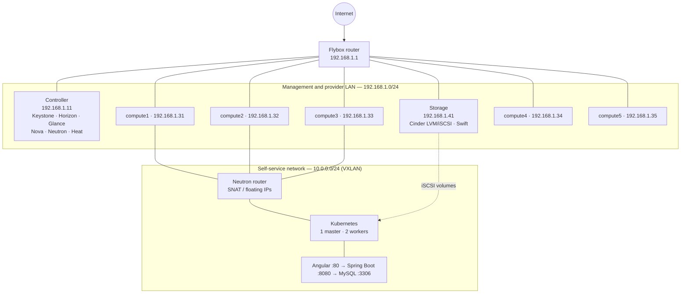

# PI Cloud

[](https://docs.openstack.org/2025.2/)
[](https://ubuntu.com/server)
[](https://www.docker.com/)
[](https://kubernetes.io/)

A private cloud built from scratch on **OpenStack Flamingo (2025.2)** and deployed on physical PCs that share one Flybox router. The cloud hosts a three-tier web application: an Angular frontend, a Spring Boot backend, and a SQL database.

Each physical machine runs one Ubuntu Server 24.04 virtual machine with nested virtualization enabled. Seven of those VMs form the OpenStack cluster: one controller, five compute nodes, and one storage node that serves both block storage (Cinder) and object storage (Swift). Instances created on that cloud then run the application stack, packaged with Docker, scheduled by Kubernetes, configured by Ansible, and observed with Prometheus and Grafana.

## 📋 Table of contents

- [Architecture](#-architecture)
- [Repository layout](#-repository-layout)
- [Prerequisites](#-prerequisites)
- [Node inventory](#-node-inventory)
- [Installation](#-installation)
  - [Phase 1 — OpenStack infrastructure](#phase-1--openstack-infrastructure)
  - [Phase 2 — Application deployment](#phase-2--application-deployment)
  - [Phase 3 — Monitoring](#phase-3--monitoring)
- [Services and ports](#-services-and-ports)
- [Horizon dashboard](#-horizon-dashboard)
- [Create and connect to an instance](#-create-and-connect-to-an-instance)
- [Known issues and troubleshooting](#-known-issues-and-troubleshooting)
- [Team](#-team)
- [License](#-license)

## 🏗️ Architecture

All seven nodes sit on the Flybox LAN `192.168.1.0/24`. Every VM has two bridged interfaces:

| Interface | Role | Addressing |
| --- | --- | --- |
| `ens3` | Management | Static IP on `192.168.1.0/24` |
| `ens4` | Provider | No IP address. Carries the OpenStack flat external network so instances can reach the internet |

Neutron uses the self-service model (Option 2) with Open vSwitch and VXLAN. Tenant instances attach to an internal network `10.0.0.0/24`. A Neutron virtual router NATs that network toward the provider network. Floating IPs are allocated from `192.168.1.200`–`192.168.1.250`.



On the tenant network, Kubernetes schedules three workloads:

| Tier | Image | Exposure |
| --- | --- | --- |
| Frontend | `cyrinekchaou/frontend-app` | LoadBalancer on port 80 |
| Backend | `cyrinekchaou/backend-app` | ClusterIP on port 8080 |
| Database | `mysql:8.0` | ClusterIP on port 3306, data on a PersistentVolumeClaim |

Screenshots of the topology, Horizon, Grafana, and the running application are in [`docs/screenshots/`](docs/screenshots/).

## 📁 Repository layout

```text
.
├── infrastructure/                 Phase 1 — OpenStack
│   ├── networking/
│   │   ├── hosts                   controller / compute / storage hostnames
│   │   ├── 00-installer-config.yaml
│   │   └── 50-cloud-init.yaml
│   └── heat/
│       ├── scenario1.yaml          single instance on the self-service network
│       ├── scenario2.yaml          instance + Cinder volume + floating IP
│       ├── scenario3.yaml          web + database stack
│       └── k8s.yaml                router, network, 1 master + 2 workers
├── deployment/                     Phase 2 and 3 — application platform
│   ├── docker/backend/Dockerfile   multi-stage Spring Boot image
│   ├── ansible/
│   │   ├── ansible.cfg
│   │   ├── inventory.ini           Kubernetes floating IPs
│   │   ├── common.yaml             containerd and kernel prep on every node
│   │   ├── master.yaml             control plane + monitoring
│   │   ├── worker.yaml             worker join
│   │   ├── occm.yaml               OpenStack cloud controller manager
│   │   ├── monitoring.yaml
│   │   └── roles/
│   └── kubernetes/
│       ├── 00-namespace.yaml       namespace: webapp
│       ├── frontend/
│       ├── backend/
│       └── db/
└── docs/
    ├── presentations/
    ├── screenshots/
    └── specifications/
```

The sample netplan files name the NICs `ens33` and `ens34`, which is what VMware guest tools report. On KVM or VirtualBox the same two bridged adapters usually appear as `ens3` and `ens4`. Match the names to `ip link` on each node before applying the config.

## ✅ Prerequisites

### Hardware

| Requirement | Minimum |
| --- | --- |
| Physical machines | 7 PCs, one VM each |
| Nested virtualization | Enabled in the BIOS and in the hypervisor (`kvm-intel` / `kvm-amd` nested, or the equivalent VMware / VirtualBox setting) |
| Controller VM | 4 vCPU, 8 GB RAM, 80 GB disk |
| Compute VM | 4 vCPU, 8 GB RAM, 80 GB disk |
| Storage VM | 2 vCPU, 4 GB RAM, extra disk or volume group for the Cinder LVM backend |
| Network | One shared Flybox router, two bridged NICs per VM |
| Guest OS | Ubuntu Server 24.04 LTS on every node |

### Software

Install these on the operator workstation (or on the controller, which is also the Ansible control host):

```bash
sudo apt update
sudo apt install -y python3-pip python3-venv git
python3 -m pip install --user ansible-core python-openstackclient
```

| Tool | Used for |
| --- | --- |
| OpenStack client | Identity, images, instances, networks, volumes |
| Ansible Core | Kubernetes node bootstrap and monitoring |
| Docker | Building the Spring Boot image |
| `kubectl` | Applying the application manifests |
| OpenStack Heat | Optional orchestration of the tenant scenarios |

## 🌐 Node inventory

Management addresses from [`infrastructure/networking/hosts`](infrastructure/networking/hosts):

| Hostname | Role | Management IP (`ens3`) | OpenStack services |
| --- | --- | --- | --- |
| `controller` | Controller | `192.168.1.11` | Keystone, Horizon, Glance, Nova API, Neutron, Heat, Placement |
| `compute1` | Compute | `192.168.1.31` | nova-compute, Neutron OVS agent |
| `compute2` | Compute | `192.168.1.32` | nova-compute, Neutron OVS agent |
| `compute3` | Compute | `192.168.1.33` | nova-compute, Neutron OVS agent |
| `compute4` | Compute | `192.168.1.34` | nova-compute, Neutron OVS agent |
| `compute5` | Compute | `192.168.1.35` | nova-compute, Neutron OVS agent |
| `storage` | Block and object storage | `192.168.1.41` | Cinder (LVM, iSCSI, tgt), Swift |

Gateway and DNS used by the controller netplan: `192.168.1.1`, `8.8.8.8`, `8.8.4.4`.

Kubernetes nodes are OpenStack instances. Their floating IPs, used by Ansible, live in [`deployment/ansible/inventory.ini`](deployment/ansible/inventory.ini):

| Group | Floating IP |
| --- | --- |
| `master` | `192.168.1.204` |
| `workers` | `192.168.1.102`, `192.168.1.231` |

## 🚀 Installation

### Phase 1 — OpenStack infrastructure

**1. Prepare each physical host**

Enable nested virtualization, create one Ubuntu Server 24.04 VM, and attach two bridged adapters to the Flybox LAN.

**2. Configure management and provider networking**

Copy the hostname map onto every node:

```bash
sudo cp infrastructure/networking/hosts /etc/hosts
```

On the controller, apply a static address. Edit the interface names if they are not `ens33` / `ens34`, then:

```bash
sudo cp infrastructure/networking/00-installer-config.yaml /etc/netplan/00-installer-config.yaml
sudo chmod 600 /etc/netplan/00-installer-config.yaml
sudo netplan apply
```

Compute and storage nodes follow the same pattern with their own address (`192.168.1.31`–`192.168.1.35` and `192.168.1.41`). Leave the provider NIC without an address. [`50-cloud-init.yaml`](infrastructure/networking/50-cloud-init.yaml) is the DHCP variant used while a node is first installed.

Confirm name resolution and the empty provider NIC:

```bash
ping -c 2 controller
ping -c 2 storage
ip -br addr
```

**3. Install OpenStack Flamingo (2025.2)**

Use the [OpenStack 2025.2 installation guide](https://docs.openstack.org/2025.2/install/) for Ubuntu. Deploy services in this order, all on Ubuntu Server 24.04:

1. Chrony on every node, with the controller as the time source.
2. MariaDB, RabbitMQ, and Memcached on the controller.
3. Keystone, then Glance.
4. Placement and Nova (API on the controller, `nova-compute` on each compute node).
5. Neutron with the self-service Option 2 architecture: OVN or the OVS mechanism driver, VXLAN tenant networks, and a flat provider bridge on `ens4`.
6. Cinder on the controller API, with the volume service on `storage` using an LVM backend exported over iSCSI (`tgt`).
7. Swift proxy and account/container/object services on `storage`.
8. Horizon on the controller.
9. Heat API and the Heat engine on the controller (used by the templates in the next step).

**4. Create the provider and self-service networks**

```bash
source ~/admin-openrc.sh

openstack network create --share --external \
  --provider-physical-network provider \
  --provider-network-type flat \
  provider

openstack subnet create --network provider \
  --allocation-pool start=192.168.1.200,end=192.168.1.250 \
  --dns-nameserver 8.8.8.8 \
  --gateway 192.168.1.1 \
  --subnet-range 192.168.1.0/24 \
  provider-subnet
```

The self-service network `10.0.0.0/24`, its subnet, and the NAT router can be created in Horizon or by the Heat templates below.

**5. Publish an image and flavors**

```bash
wget https://cloud-images.ubuntu.com/jammy/current/jammy-server-cloudimg-amd64.img

openstack image create "ubuntu-22.04" \
  --file jammy-server-cloudimg-amd64.img \
  --disk-format qcow2 \
  --container-format bare \
  --public

openstack flavor create --vcpus 2 --ram 4096 --disk 20 m1.medium
openstack keypair create --public-key ~/.ssh/id_rsa.pub my-key
```

**6. Optional: stand up tenant scenarios with Heat**

Run these from a host that has `admin-openrc` (or a project openrc) sourced.

```bash
openstack stack create -t infrastructure/heat/scenario1.yaml scenario1
openstack stack create -t infrastructure/heat/scenario2.yaml scenario2
openstack stack create -t infrastructure/heat/scenario3.yaml scenario3
openstack stack create -t infrastructure/heat/k8s.yaml k8s
```

| Template | What it creates |
| --- | --- |
| `scenario1.yaml` | One instance on the existing `selfservice` network |
| `scenario2.yaml` | One instance, a Cinder volume, and a floating IP |
| `scenario3.yaml` | Private network, router, web and database instances, volumes, floating IP |
| `k8s.yaml` | Private network `10.10.0.0/24`, router, 1 master and 2 workers, a volume per node, floating IPs, Ansible user and security groups |

### Phase 2 — Application deployment

**1. Build and push the backend image**

The frontend image is built from the Angular project and pushed the same way. The backend Dockerfile is a two-stage build on Eclipse Temurin 17. It runs as a non-root user and listens on port 8080.

```bash
docker build -t cyrinekchaou/backend-app:latest deployment/docker/backend
docker push cyrinekchaou/backend-app:latest
```

**2. Bootstrap Kubernetes with Ansible**

Ansible runs from the controller and reaches the cluster over the floating IPs in `inventory.ini`. Point `ansible_ssh_private_key_file` at the Nova key (`my-key` by default).

```bash
cd deployment/ansible
ansible -m ping all
ansible-playbook common.yaml
ansible-playbook master.yaml
ansible-playbook worker.yaml
ansible-playbook occm.yaml
```

| Playbook | Role |
| --- | --- |
| `common.yaml` | Disable swap, load `overlay` and `br_netfilter`, install containerd |
| `master.yaml` | Kubernetes control plane, then the monitoring role |
| `worker.yaml` | Join workers with `roles/worker/files/join-command.sh` |
| `occm.yaml` | OpenStack cloud controller manager so `Service type: LoadBalancer` can allocate a floating IP |

Before `occm.yaml`, edit the cloud config written by `roles/occm` so `auth-url`, project, subnet, and external network match this cloud.

**3. Deploy the three-tier application**

```bash
cd deployment/kubernetes
kubectl apply -f 00-namespace.yaml
kubectl apply -f db/
kubectl apply -f backend/
kubectl apply -f frontend/
kubectl get pods,svc -n webapp
```

Manifests live in the `webapp` namespace. The database uses a `Recreate` strategy because its volume is `ReadWriteOnce`. Backend and frontend requests are declared in their deployments and can scale through the HorizontalPodAutoscalers in `backend/hpa.yaml` and `db/hpa.yaml`.

### Phase 3 — Monitoring

The monitoring role is included from `master.yaml`. To apply it on its own:

```bash
cd deployment/ansible
ansible-playbook monitoring.yaml
```

What gets installed:

| Component | Where | Port |
| --- | --- | --- |
| Node Exporter | Each Kubernetes node | `9100` |
| Prometheus | Master (`prom/prometheus`) | `9090` |
| Grafana | Master (`grafana/grafana`) | `3000` |

Prometheus is configured from `roles/monitoring/templates/prometheus.yml.j2` with a 15-second scrape interval. Grafana’s initial admin password is set in `roles/monitoring/templates/docker-compose.yml.j2`. Change it after the first login.

Open Grafana at `http://192.168.1.204:3000` (the master floating IP) and import a Node Exporter dashboard to graph CPU, memory, and disk on every node.

## 🔌 Services and ports

### OpenStack control plane (controller `192.168.1.11`)

| Service | Purpose | Port |
| --- | --- | --- |
| Keystone | Identity and authentication | `5000` |
| Horizon | Web dashboard (Apache) | `80` |
| Glance | Image service | `9292` |
| Nova API | Compute API | `8774` |
| Placement | Resource inventory | `8778` |
| Neutron | Networking API | `9696` |
| Heat | Orchestration API | `8004` |
| Cinder API | Block storage API | `8776` |
| MariaDB | Service database | `3306` |
| RabbitMQ | Message bus | `5672` |
| Memcached | Token cache | `11211` |

### Storage node (`192.168.1.41`)

| Service | Purpose | Port |
| --- | --- | --- |
| Swift proxy | Object storage API | `8080` |
| Cinder volume / tgt | iSCSI target for block volumes | `3260` |

### Application and observability

| Service | Purpose | Port |
| --- | --- | --- |
| Angular frontend | Web UI | `80` |
| Spring Boot backend | REST API | `8080` |
| MySQL | Application database | `3306` |
| Prometheus | Metrics | `9090` |
| Grafana | Dashboards | `3000` |
| Node Exporter | Host metrics | `9100` |
| Kubernetes API | Cluster API on the master | `6443` |

## 🖥️ Horizon dashboard

Horizon is served by Apache on the controller.

1. From a machine on the Flybox LAN, open `http://192.168.1.11/horizon`.
2. Domain: `Default`.
3. Sign in with the admin user created during the Keystone install, or with a project user.
4. Set the region to `RegionOne`.

Useful pages after login: **Project → Network → Network Topology**, **Compute → Instances**, **Volumes**, and **Orchestration → Stacks**.

## 💻 Create and connect to an instance

Source the project credentials, then create a private network if Heat has not already created one:

```bash
source ~/demo-openrc.sh

openstack network create selfservice
openstack subnet create --network selfservice \
  --dns-nameserver 8.8.8.8 \
  --gateway 10.0.0.1 \
  --subnet-range 10.0.0.0/24 \
  selfservice-subnet

openstack router create router
openstack router set --external-gateway provider router
openstack router add subnet router selfservice-subnet
```

Allow SSH and ICMP, boot the instance, and attach a floating IP:

```bash
openstack security group create demo-sg
openstack security group rule create --proto icmp demo-sg
openstack security group rule create --proto tcp --dst-port 22 demo-sg

openstack server create \
  --flavor m1.medium \
  --image ubuntu-22.04 \
  --network selfservice \
  --security-group demo-sg \
  --key-name my-key \
  demo-vm

FLOATING_IP=$(openstack floating ip create -f value -c floating_ip_address provider)
openstack server add floating ip demo-vm "$FLOATING_IP"

ssh -i ~/.ssh/my-key ubuntu@"$FLOATING_IP"
```

The same flow is encoded in `infrastructure/heat/scenario2.yaml` if you prefer a stack over individual CLI calls.

## 🛠️ Known issues and troubleshooting

**Provider interface has an address, or instances have no internet.**  
`ens4` (or `ens34` in the sample netplan) must stay unnumbered. An address on that NIC makes it compete with `br-ex`. Remove the address, map the NIC as the Neutron flat provider bridge, and restart the OVS and Neutron agents.

**Floating IPs from `192.168.1.200`–`192.168.1.250` never answer.**  
Exclude that range from the Flybox DHCP pool so the router does not lease those addresses to physical devices. Confirm `ip netns` shows the router namespace and that security groups allow the traffic you are testing.

**VXLAN tenant traffic is dropped.**  
Encapsulation adds overhead. Set the self-service MTU to `1450` when the physical LAN MTU is `1500`. A larger MTU shows up as SSH sessions that stall after the key exchange.

**`nova-compute` is down on a compute node.**  
Nested virtualization is required for KVM guests inside the compute VM. Check `kvm-ok` (or `egrep -c '(vmx|svm)' /proc/cpuinfo` on the guest) and the hypervisor nested-virt setting. `journalctl -u nova-compute` reports the libvirt error when `/dev/kvm` is missing.

**Cinder volumes stay `creating` or fail to attach.**  
On the storage node the LVM volume group must exist, `tgt` must be running, and compute nodes must reach TCP `3260`. Check `openstack volume service list` and `systemctl status tgt cinder-volume`.

**Nodes cannot resolve each other during install.**  
Install `/etc/hosts` from `infrastructure/networking/hosts` before starting RabbitMQ or the OpenStack services. Clock skew between controller and compute also breaks Keystone tokens; verify Chrony first.

**Ansible cannot reach the Kubernetes nodes.**  
The inventory uses floating IPs and `~/.ssh/my-key`. The key must match the Nova keypair `my-key`, and the master security group must allow TCP `22` from the controller.

**Kubernetes pods stay `ContainerCreating`.**  
`common.yaml` turns swap off and loads `br_netfilter`. Re-run it if a node was rebooted and swap came back from `/etc/fstab`. Then check `kubectl describe pod -n webapp`.

**The frontend LoadBalancer has no external IP.**  
`frontend/service.yaml` expects the OpenStack cloud controller manager. Run `occm.yaml` only after `auth-url`, tenant, subnet, and `floating-network-id` in that role match the live cloud. Without it, change the Service to `NodePort` and reach the workers on that node port.

**Swift and the sample backend both use port 8080.**  
Swift’s proxy on the storage node and the Spring Boot process inside a pod are different hosts, so they do not bind the same address. Avoid publishing the backend with `hostNetwork` on the storage node.

**Grafana login is rejected.**  
The compose template sets the initial admin password the first time the Grafana volume is created. Reset it from the master if the volume already existed:

```bash
docker exec -it grafana grafana-cli admin reset-admin-password '<new-password>'
```

## 👥 Team

| Name | Role |
| --- | --- |
| Sirine Kchaw | Compute |
| Zeineb Korbi | Compute |
| Oussema Mrabet | Compute |
| Yasser Jaziri | Compute |
| Yassine Mharek | Compute |
| Ghada Omri | Storage |

Replace this table with the project group and each person’s responsibility (infrastructure, networking, Kubernetes, monitoring).

## 📄 License

This project is released under the [MIT License](LICENSE).
